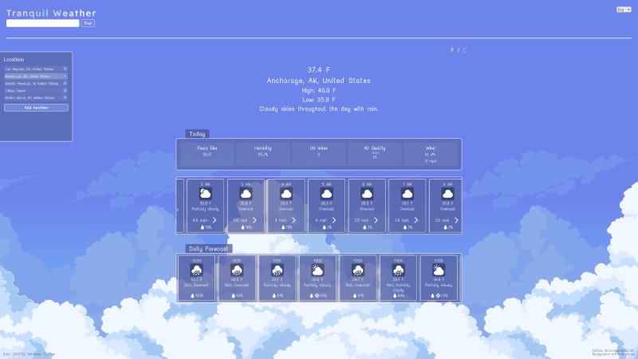
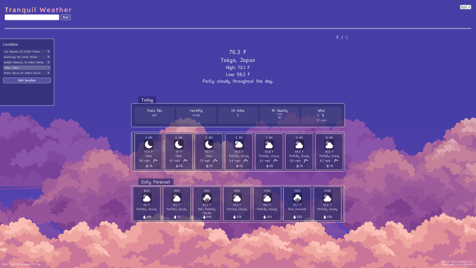
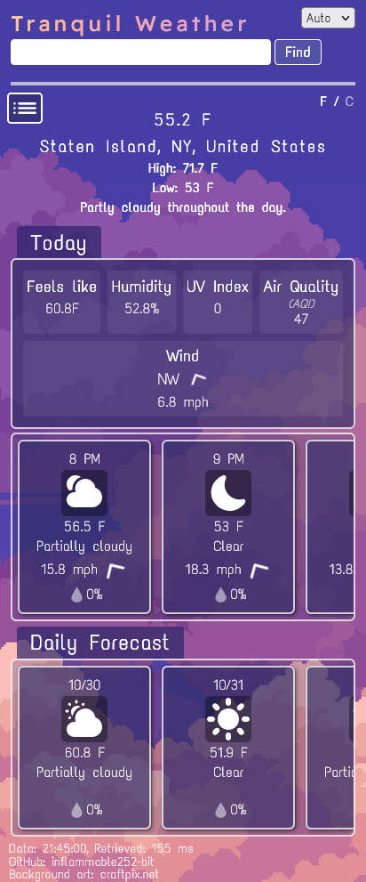
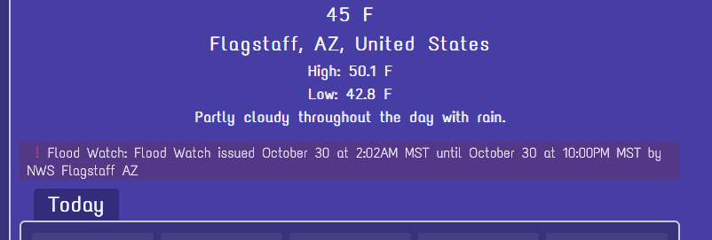

# Tranquil Weather

A simple and responsive weather application. Users enter a location and data is fetched to display information and update elements on a clean interface. Built with JavaScript/TypeScript and bundled with Webpack.

Created as part of the JavaScript course of The Odin Project with the goal of processing data from an API. Additional concepts were practiced, namely TypeScript, GitHub Actions, and Webpack configurations.

## Features

- Search for locations in flexible formats
- Switch between US and metric units
- Detailed information, such as humidity and wind speed
- Dynamic icons for current conditions, precipitation, and wind direction
- Scrollable section with hourly information for the next 24-hour period
- Scrollable section with daily information for the next two weeks
- Day and night modes, with an option to change depending on location time relative to its sunset
- Save locations and mode selection
- Responsive design with collapsible sidebar
- Progress bar for loading and initializing data

## Screenshots

## Future considerations

- Dynamic themes for specific conditions, such as stormy weather during the day
- Clickable cards to expand and display additional information
- Clickable forecast cards to display hourly information for that day
- Collapsible weather alerts section: Alerts currently stack. On the rare occasion of an area having 3 or more alerts, the section becomes too verbose. A cleaner solution would be to store them in a compact, but prominent element that can be expanded or display a modal window.
- Icons for weather alerts based on event titles (i.e. A flowing water icon for a flood watch)

## Other

Weather Data: [Visual Crossing Weather API](https://www.visualcrossing.com/)  
Background image credits: [CraftPix](https://craftpix.net/)
